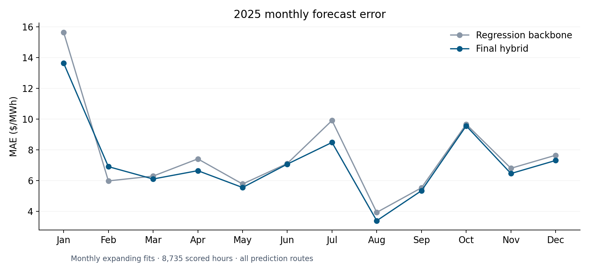
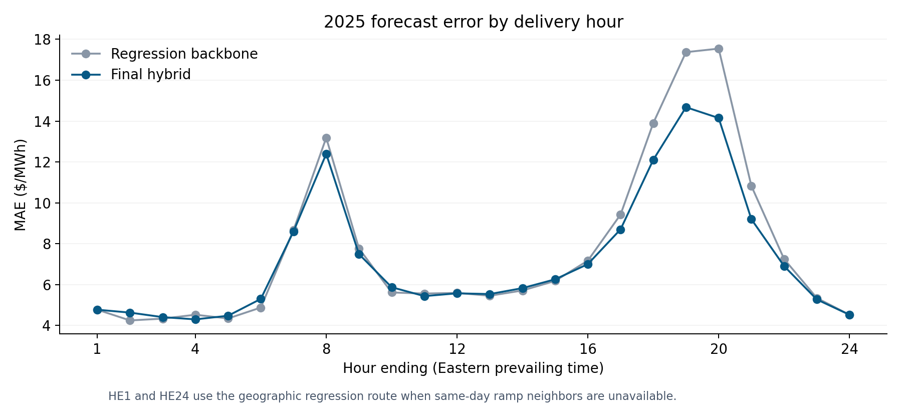

# PJM Day-Ahead Electricity Price Forecasting

A Python quantitative research project forecasting the hourly **PJM day-ahead system energy price**, in $/MWh. The model combines seasonal remaining-demand curves with regional natural gas prices, forecast generation outages, geographic load composition, and forecast ramps. A boosted-tree residual correction captures additional interactions. This is a system-energy forecast, not a nodal congestion model or an automated trading system.

## Market intuition

Remaining demand is forecast load minus forecast wind and solar generation. Higher remaining demand can require more expensive resources, creating a nonlinear price response. Gas prices proxy fuel costs; outages proxy supply pressure. Regional load composition and the shape of the next day's load profile provide information beyond the system total. These are statistical relationships, not a reconstruction of the auction or a causal dispatch model.

## Results

The **2025 monthly expanding backtest** scores 8,735 hourly observations across January–December. The regression backbone achieved **MAE 7.6734** and **RMSE 14.4526 $/MWh**. The final hybrid achieved **MAE 7.2239** and **RMSE 13.5949 $/MWh**, improvements of approximately **5.86%** and **5.94%** respectively on the same hours. Mean signed error was **−2.2891 $/MWh**, indicating remaining underprediction.

The model uses its complete hybrid route for 7,699 hours and simpler fallback routes for 1,036 hours. On the complete-input subset, hybrid MAE/RMSE were **7.2116 / 13.2013 $/MWh**; this is a different population from the headline results. The 25-hour autumn clock-reversal day is excluded under the retained data policy. The annual metrics are development-backtest results: the period was used during model selection.



*Monthly fits use earlier observations. Both lines include every scored prediction route, making the backbone/hybrid comparison directly comparable.*



*Hourly errors use Eastern prevailing time. Same-day boundary hours lack both ramp neighbors and use the geographic fallback.*

For a separate **October 27, 2026 next-day forecast**, the 24-hour MAE was **8.2126** and RMSE **12.8918 $/MWh**. The predicted daily average was **57.0091**, versus **54.5554** actual. The predicted HE8–23 average was **60.9161**, versus **60.6719** actual. Agreement of the peak average does not imply small hourly errors: peak-hour MAE was **8.8825 $/MWh**. This is one forecast day, reported separately from the annual backtest.

Aggregate scores are in [`results/`](results/). The published runner was replayed against the original prepared inputs: all 8,735 annual predictions and all 24 October 27 prices matched preserved outputs within **$0.000001/MWh**. See [validation](docs/validation.md).

## Method

1. Prepare hourly delivery timestamps and compute remaining demand and same-day forecast ramps.
2. Fit weighted ridge regression with separate natural cubic remaining-demand splines for each season, calendar effects, six gas prices, and Western/Other outages.
3. Add regularized regional excess-demand terms for Dominion, ComEd, ATSI, PPL, and PSE&G.
4. Fit a gradient-boosted tree correction to earlier held-out regression residuals.
5. Add the correction on the full-input route; use progressively simpler regressions or calendar means when inputs are missing.

The regression uses 89 predictors plus an intercept. Both stages use a **365.2425-day weight half-life**. The correction uses 150 trees, learning rate 0.03, depth 6, and minimum leaf size 24. Full details and the gas series mapping are in [methodology](docs/methodology.md).

## Run a self-contained demonstration

Python **3.12** is the tested environment.

```bash
python -m venv .venv
source .venv/bin/activate
python -m pip install -r requirements.txt
python demo.py
python -m unittest discover -s tests -v
```

Windows activation: `.venv\Scripts\activate`.

The demo fits the actual model on generated synthetic history and writes `demo_output/synthetic_forecast.csv` plus a summary. **Synthetic demo outputs are not market results and are not the source of the reported accuracy.** No API key or downloaded data is needed for this demonstration.

## Reproduce the research forecast or backtest

The repository contains the original compact model and runner, but **does not redistribute bulk historical market inputs**. The full runs require a separately held prepared input bundle. The bundle schema, checksums, and source conventions are described in [data documentation](docs/data.md). Raw-feed preparation and regeneration of the earlier residual sequence are outside this compact release.

```bash
python run_forecast.py --data-dir /path/to/prepared-data --output forecast_output
python run_forecast.py --data-dir /path/to/prepared-data --backtest-2025 --output results/backtest_2025
```

The first command defaults to October 27, 2026. It writes hourly prices, regression/correction breakdowns, and summary statistics. The second refits monthly through 2025 and checks every prediction against the reference bundle. Existing output directories are protected against overwriting. The runner accepts ordinary 24-hour forecast days; it does not claim general DST-day export support.

To regenerate the two figures from the included aggregate results:

```bash
python -m pip install -r requirements-dev.txt
python scripts/plot_results.py
```

## Data and limitations

Market inputs use PJM load, renewable, outage, and day-ahead price observations, alongside regional gas indexes. UTC identifies physical hours; `America/New_York` defines local delivery dates and calendar features. The retained feature timing and solar hour-mapping conventions are documented in [data documentation](docs/data.md). They are preserved here rather than changed during packaging.

Remaining limitations include price spikes, regime changes, sparse high-demand support, incomplete supply/offer information, and geographic constraints not represented by system energy prices. Spline tails are linear and unconstrained; tree corrections cannot reliably extrapolate beyond learned support. Historical residuals are supplied intermediate training observations, not regenerated by the compact runner. The model was developed with repeated inspection of 2025, so these results should not be called an untouched test.

Potential next steps are a frozen-specification evaluation on new periods, richer supply and transmission features, and route-specific corrections for missing-input hours.

## Attribution

Public source references: [PJM Data Miner 2](https://dataminer2.pjm.com/), [PJM API](https://api.pjm.com/), and [PJM day-ahead energy market](https://www.pjm.com/markets-and-operations/energy/day-ahead).

This is a personal research project. It is not investment advice. The MIT license covers the original code and documentation; third-party market data retain their own terms and are not included under that license.
